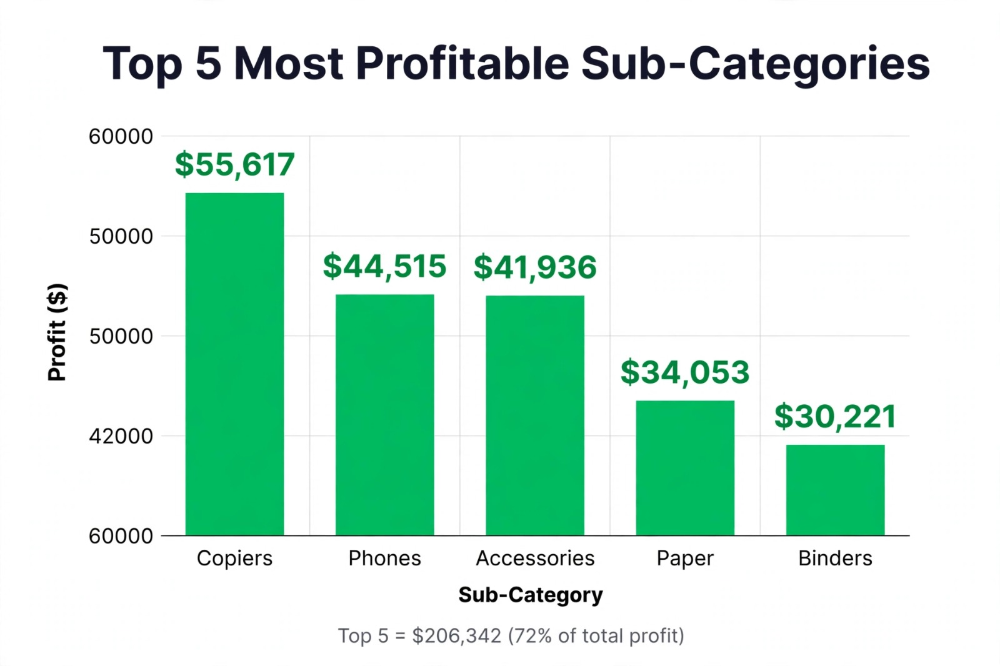

# Superstore Sales & Profit Analysis

## 📊 Project Overview
Analyzed 9,994 superstore orders to find which products drive maximum profit.

## 🎯 Problem Statement
Which sub-categories are most profitable? Where is profit leaking?

## 🔧 What I Did
- Cleaned dataset: Checked 21 columns for nulls, fixed Order Date format
- Used Pandas: `groupby('Sub-Category')['Profit'].sum()` and `nlargest(5)`
- Visualized with Matplotlib bar chart

## 💡 Key Findings
**Total Profit: $286,397 | Top 5 Sub-Categories: $206,345 (72% of total profit)**

1. Copiers: $55,617
2. Phones: $44,515
3. Accessories: $41,936
4. Paper: $34,053
5. Binders: $30,221

- Copiers + Phones alone = 49% of Top 5 profit
- Tables category in loss (-$17,725) due to high discounts (20-30%)

## 📈 Visualization

## 🛠️ Tools Used
Python, Pandas, Matplotlib, Excel, GitHub

## ✅ Business Recommendation
- Increase stock & marketing for Copiers & Phones
- Reduce discount on Tables category from 30% to 10%

## 🔗 Dataset
Sample Superstore Dataset (Kaggle) - 9,994 rows, 2014-2017

## 👤 Author
Adithkrishna AJ - MCA Graduate | Aspiring Data Analyst
GitHub: @adith18
